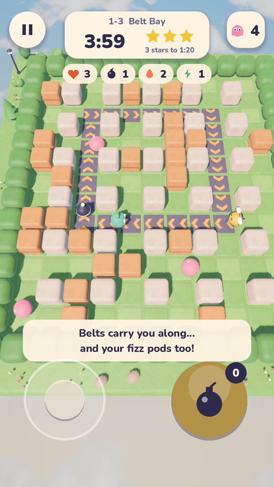
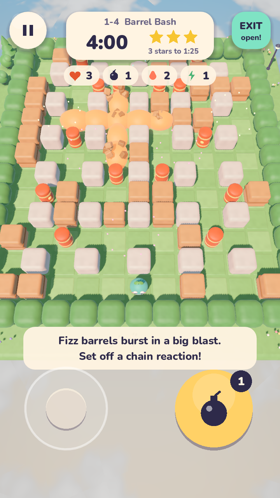
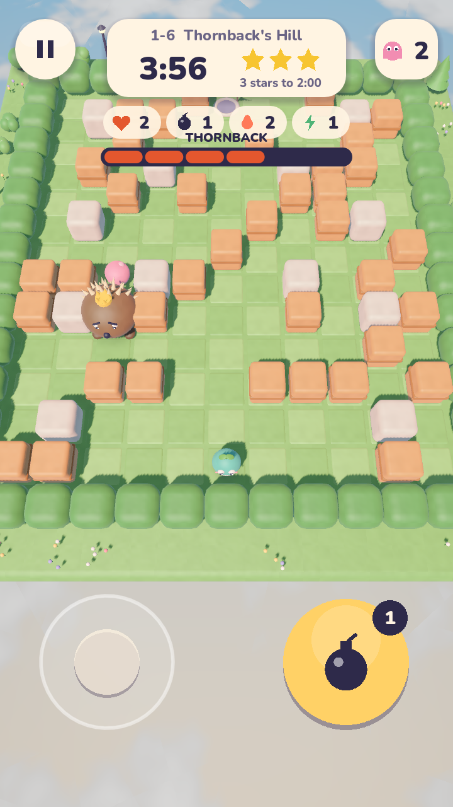

# Boomlets

Pop pods. Blast crates. Outsmart the critters!

Boomlets is a cozy 3D arena game for Android. Help Pip clear floating sky islands: drop fizzy pods, break crates, grab power-ups and pop every critter to open the exit.

**[Download the latest APK](https://github.com/manpreetgugga/boomlets/releases/latest)** (Android 7+, arm64)

  
  
  
  

## How to play

- **Move:** drag anywhere on the left half of the screen.
- **Drop a pod:** tap the right half.
- Pods pop after 2.5 seconds and blast in a plus shape. Blasts set off other pods.
- Pop every critter to open the exit pad, then walk onto it.
- Finish quickly for 3 stars.

### Power-ups (from broken crates)

| Power-up | Effect |
|---|---|
| Pod | Carry one more pod |
| Fire | Longer blasts |
| Speed | Move faster |
| Kick | Walk into a pod to send it sliding |
| Shield | Blocks one hit |
| Heart | Extra life |

## World 1: Meadow Isles

| # | Level | New twist |
|---|---|---|
| 1 | Fizzy Start | The basics |
| 2 | Buzz Lane | Buzzers that chase you |
| 3 | Belt Bay | Conveyor belts that carry you and your pods |
| 4 | Barrel Bash | Fizz barrels that blow up in chains |
| 5 | Warp Woods | Warp pads and Wisps that float through crates |
| 6 | Thornback's Hill | Boss fight |

## Building from source

1. Install [Godot 4.7](https://godotengine.org/) and open this folder as a project.
2. Press **Play** to run it on your computer. Arrow keys or WASD move, Space drops a pod and Esc pauses.
3. To build an APK, install the Android export templates and set the Android SDK path in Godot's editor settings, then use **Project > Export > Android**.

The signed release build uses `tools/build_release.ps1`. It asks for the keystore password and never stores it. The keystore itself is not in this repo.

### Project layout

| Folder | Contents |
|---|---|
| `game/` | Arena rules: movement, pods, blasts, critters, boss |
| `core/` | Levels, save file, sound |
| `render/` | Clay models built in code |
| `ui/` | Menu, level map, HUD and buttons |
| `shaders/` | Clay, sky and shadow shaders |
| `tools/` | Screenshot, icon and release build scripts |

## Credits

Made by Manpreet Gugga. Nunito font by Vernon Adams and others, under the SIL Open Font License (`fonts/OFL.txt`).
